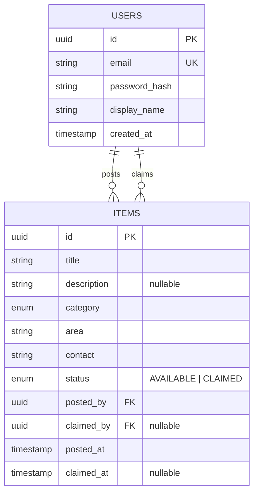

# Giveaway API

A neighbourhood surplus-giveaway API. Post things you don't need; neighbours claim them.

## The problem

Two people tap "Claim" on the same sofa at the same instant. Exactly one must win,
the other must be told no — and the loser must **never** be told yes.

The naive version reads the item, checks `status == AVAILABLE` in Java, then saves.
Under concurrency both requests pass the check before either writes, both are told
they won, and the second write silently overwrites the first — a **lost update**.

## The solution

The check and the write happen in one atomic statement:

```sql
UPDATE items
SET status = 'CLAIMED', claimed_by = :userId, claimed_at = :now
WHERE id = :itemId AND status = 'AVAILABLE';
```

The database decides the winner. The number of rows affected is the answer:

- **1 row** → this request won → `200 OK`
- **0 rows** → someone else got there first → `409 Conflict`

No `SELECT ... FOR UPDATE`, no version column, and no lock held across a network
round trip — an optimistic compare-and-set on the status itself.

Other rules: claiming your own item → `403`; re-claiming an item you already hold
→ `200` (idempotent); the poster's contact details are hidden until you've claimed.

## The proof

`ClaimConcurrencySpec` (Spock) fires two claims at the same moment:

- two threads wait on a `CountDownLatch`, released together so they genuinely collide
- outcomes are collected through `Future.get()`, so exceptions inside threads reach the assertions
- it asserts on the **pair**: exactly one success **and** exactly one conflict

To prove the test catches the bug, I removed `AND status = 'AVAILABLE'` and re-ran it.
It failed with two successes — both users told `claimedByMe=true` — then passed again
once the condition was restored.

The spec runs on every push via GitHub Actions against a real Postgres.

## Status

The claim flow is complete and tested. Still to come: authentication
(requests currently carry a `Giveaway-User-Id` header as a deliberate
stand-in for a JWT), the filtered list endpoint, release-claim, and
image upload.

Design decisions and their trade-offs are recorded in
[`docs/CHALLENGES.md`](docs/CHALLENGES.md) — including the duplicate-create
problem and why idempotency keys are the answer.

## Running it

```bash
docker compose up -d            # Postgres on localhost:5433
cd api && ./mvnw spring-boot:run
./scripts/smoke.sh              # end-to-end: create, privacy check, all four claim outcomes
./mvnw test                     # unit + concurrency specs
```

## Stack

Java 21 · Spring Boot 4.1 · Spring Data JPA · PostgreSQL 16 · Spock 2.4 / Groovy 5 · GitHub Actions

## Data model



Read each relationship both ways:

- A user **posts** one or many items — an item **is posted by** exactly one user.
- A user **claims** one or many items — an item **is claimed by** at most one user.

That second sentence is where the nullable columns come from: an item must have a
poster, but may have no claimer. A null `claimed_by` *is* "available".

### Why only two tables

- `category` and `status` are enums, not tables. Fixed sets with nothing to say
  about themselves don't earn a row.
- `contact` is per-item, not per-user — you might give a phone number for one item
  and an email for another. It would only need its own table if an item could have
  several contacts.
- There is no `claims` table. A claim is `claimed_by` + `claimed_at` on the item.
  It would become a table the day we need claim *history* rather than the current
  claimer.

More detail in [`docs/`](docs/).