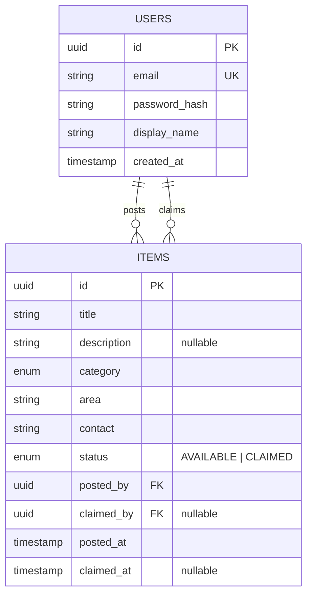

## Data model

Read each relationship both ways:

- A user **posts** many items — an item **is posted by** exactly one user.
- A user **claims** many items — an item **is claimed by** at most one user.

That second sentence is where the nullable columns come from: an item must have a
poster, but may have no claimer. A null `claimed_by` *is* "available".

### Why only two tables

- `category` and `status` are enums, not tables. Fixed sets with nothing to say
  about themselves don't earn a row.
- `contact` is per-item, not per-user — you might give a phone number for one item
  and an email for another. It would only need its own table if an item could have
  several contacts.
- There is no `claims` table. A claim is `claimed_by` + `claimed_at` on the item.
  It would become a table the day we need claim *history* rather than the current
  claimer.
